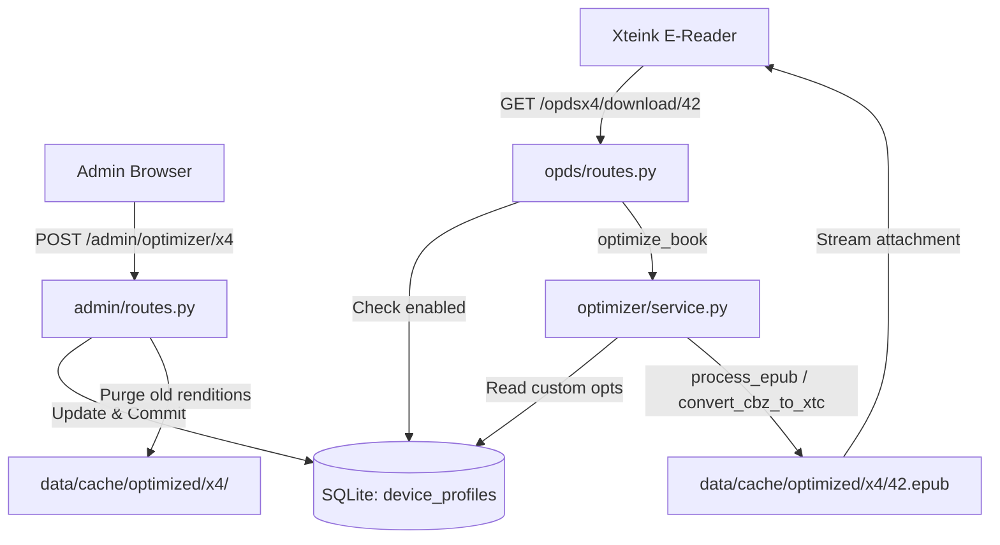

# Implementation Plan: Optimizer Configuration in Admin Dashboard

## Goal Description
Provide BookFlow administrators with a dedicated **Optimizer** settings panel in the `/admin` interface to configure on-demand optimization parameters for supported e-ink device profiles. This includes:
1. **Device Resolution & Dimensions**: Configurable width and height for target device profiles.
2. **CBZ / Comic Conversion Options (`cbz2xtc`)**: Toggling Floyd-Steinberg dithering, spread splitting, and spread rotation.
3. **EPUB Processing Options (`epubkit`)**: Tuning image compression quality (1–100), contrast boost, grayscale conversion, embedded font stripping, and CSS cleanup.
4. **Catalog Toggles**: Enabling or disabling individual device catalogs (e.g., hiding `/opdsx3` if only X4 devices are in use).
5. **Safe Cache Invalidation**: Automatically clearing a profile's cache when its visual or resolution settings are updated, ensuring readers receive freshly optimized files.

---

## User Review Required

> [!IMPORTANT]
> **Database Schema Migration (`0005_device_profiles.py`)**:
> A new database table `device_profiles` will store profile settings in SQLite. Default rows for `x3` and `x4` will be seeded during migration with current production defaults, ensuring seamless backward compatibility without breaking existing libraries.

> [!WARNING]
> **Automatic Cache Invalidation on Setting Changes**:
> Saving changes to a device profile's dimensions, dithering, or image quality will automatically purge cached files for that specific profile (`data/cache/optimized/<profile>/`). Existing books in your library are untouched, but subsequent downloads for that profile will re-optimize on-demand with the new settings.

---

## Open Questions

> [!NOTE]
> 1. **Extensibility vs. Fixed Profiles**:
>    Should BookFlow support creating arbitrary custom named profiles (e.g. `kobo`, `kindle`), or focus specifically on configuring and toggling the primary hardware targets (`x3` and `x4`)?
>    *Recommendation:* Start with configurable `x3` and `x4` profiles (which match the existing dedicated feed routes `/opdsx3` and `/opdsx4`), structured internally so arbitrary profiles can be added without further schema changes.
>
> 2. **Disabled Catalog Behavior**:
>    When an admin toggles a profile to disabled (e.g., `x3` disabled):
>    - Its link and entry are hidden from `/opds` root feed.
>    - Direct requests to `/opdsx3` or `/opdsx3/download/<id>` will return HTTP 404.

---

## Architecture Flow



---

## Proposed Changes

### Database Layer

#### [MODIFY] `src/bookflow/database/models.py`
Add `DeviceProfile` ORM model:
```python
class DeviceProfile(Base):
    """Configuration settings for a device optimization profile."""

    __tablename__ = "device_profiles"

    id: Mapped[int] = mapped_column(Integer, primary_key=True)
    name: Mapped[str] = mapped_column(String(32), unique=True, nullable=False, index=True)
    display_name: Mapped[str] = mapped_column(String(128), nullable=False)
    enabled: Mapped[bool] = mapped_column(Boolean, default=True, nullable=False)

    # Resolution
    target_width: Mapped[int] = mapped_column(Integer, nullable=False)
    target_height: Mapped[int] = mapped_column(Integer, nullable=False)

    # CBZ / comic options
    cbz_dither: Mapped[bool] = mapped_column(Boolean, default=True, nullable=False)
    cbz_split_spreads: Mapped[bool] = mapped_column(Boolean, default=True, nullable=False)
    cbz_rotate_spreads: Mapped[bool] = mapped_column(Boolean, default=True, nullable=False)

    # EPUB options
    epub_grayscale: Mapped[bool] = mapped_column(Boolean, default=True, nullable=False)
    epub_contrast_boost: Mapped[bool] = mapped_column(Boolean, default=True, nullable=False)
    epub_quality: Mapped[int] = mapped_column(Integer, default=70, nullable=False)
    epub_remove_fonts: Mapped[bool] = mapped_column(Boolean, default=True, nullable=False)
    epub_remove_unused_css: Mapped[bool] = mapped_column(Boolean, default=True, nullable=False)
    epub_text_cleanup: Mapped[bool] = mapped_column(Boolean, default=True, nullable=False)

    created_at: Mapped[datetime] = mapped_column(DateTime, server_default=func.now(), nullable=False)
    updated_at: Mapped[datetime] = mapped_column(
        DateTime, server_default=func.now(), onupdate=func.now(), nullable=False
    )
```

#### [NEW] `migrations/versions/0005_device_profiles.py`
Alembic migration that creates `device_profiles` and populates the default rows for `x3` and `x4`:
- `x3`: display name "Xteink X3", width 528, height 792, all defaults True, quality 70.
- `x4`: display name "Xteink X4", width 480, height 800, all defaults True, quality 70.

---

### Optimizer Service Layer

#### [MODIFY] `src/bookflow/optimizer/service.py`
- Add `get_device_profile(profile_name: str) -> DeviceProfile | None` (or dict) using `session_scope()`.
- Add `clear_profile_cache(profile: str) -> tuple[int, int]` to purge cache entries for a single profile when its settings change.
- In `_generate()`, load the profile's `DeviceProfile` record and construct:
  - `ProcessingOptions(device=profile, grayscale=..., quality=..., contrast_boost=..., remove_fonts=..., remove_unused_css=..., text_cleanup=...)`
  - `ConvertOptions(target_width=..., target_height=..., dither=..., split_spreads=..., rotate_spreads=...)`
- Fallback to current hardcoded constants if database table is not yet seeded.

---

### Admin Interface Layer

#### [MODIFY] `src/bookflow/admin/routes.py`
- Add route `GET /admin/optimizer`:
  - Queries all `DeviceProfile` records.
  - Passes current profiles, cache sizes, and defaults to `optimizer.html`.
- Add route `POST /admin/optimizer/<profile_name>`:
  - Validates inputs (e.g. `target_width` & `target_height` > 0, `epub_quality` between 1 and 100).
  - Updates the `DeviceProfile` record.
  - Automatically invalidates cache for this profile via `clear_profile_cache(profile_name)`.
  - Flashes success message: `"Updated settings for {display_name}. Cached renditions were cleared."`

#### [NEW] `src/bookflow/templates/optimizer.html`
- Clean Jinja2 template extending `layout.html`.
- Card layout for each profile with form controls:
  - **Status**: Enabled checkbox / badge.
  - **Screen Dimensions**: Target Width and Height (number inputs).
  - **Comic Settings (CBZ → XTC)**: Dithering, Split spreads, Rotate spreads.
  - **Book Settings (EPUB)**: Image Quality (number 1-100), Grayscale, Contrast boost, Strip fonts, Clean CSS, Normalize text.
  - **Cache Stats**: Displays current cached book count and size for this profile with a quick "Purge Cache" button.

#### [MODIFY] `src/bookflow/templates/layout.html`
- Add `<a href="{{ url_for('admin.optimizer_settings') }}">Optimizer</a>` to the site navigation bar for authenticated administrators.

---

### OPDS Catalog Layer

#### [MODIFY] `src/bookflow/opds/routes.py`
- In `_catalog_root(None)`: check `is_profile_enabled(profile)` before adding subsections for `X3 Catalog` or `X4 Catalog`.
- In `x3_feed()`, `x4_feed()`, and `_optimized_download()`: check whether the profile is enabled. If disabled, abort with `404 Not Found`.

---

## Verification Plan

### Automated Tests
1. **Migration Test**:
   - `uv run alembic upgrade head` creates the table and seeds default rows.
2. **Optimizer Dynamic Options Test**:
   - Test that changing dimensions (e.g., width=600, height=900) or quality passes through to `process_epub` and `convert_cbz_to_xtc`.
   - Test cache invalidation upon updating profile settings.
3. **Admin Routes Test**:
   - `GET /admin/optimizer`: renders form with current values.
   - `POST /admin/optimizer/x4`: updates DB, validates bounds (rejects invalid quality or negative dimensions).
   - Unauthorized/Reader account access rejected (403/302).
   - CSRF protection verified.
4. **OPDS Catalog Toggles Test**:
   - When `x3` is disabled, `/opds` navigation feed omits the X3 link.
   - When `x3` is disabled, `/opdsx3` returns 404.
5. **Full Suite**:
   - `uv run ruff check .`
   - `uv run pytest -q`

### Manual Verification
1. Log in to the admin panel at `http://127.0.0.1:8000/admin`.
2. Click the new **Optimizer** tab in the top navigation.
3. Toggle X3 catalog off and save -> verify `/opds` in a browser or KOReader no longer shows "X3 Catalog".
4. Adjust X4 resolution or comic dithering -> verify flash notification indicates settings saved and cache was cleared.
